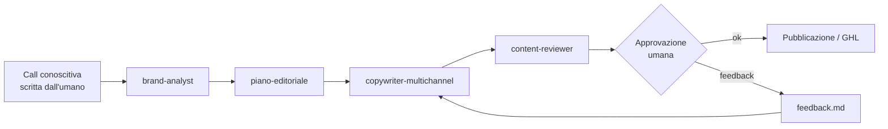

# 1 · Sistema contenuti multi-cliente con Claude

**Ruolo:** progettazione e implementazione · **Periodo:** aprile 2026 → oggi · **Stack:** Claude Cowork, Agent Skills, Markdown, GoHighLevel

## Il problema

In agenzia ogni cliente richiede post social, articoli blog e newsletter. Usare l'AI "a braccio", una chat alla volta, portava a tre problemi:

- **si perdeva il contesto**: a ogni sessione bisognava rispiegare brand, tono e storico;
- **il rischio di mescolare i clienti**: informazioni di un cliente nei testi di un altro;
- **qualità variabile**: dipendeva da chi scriveva il prompt quel giorno.

## Cosa ho costruito

Un sistema nato con **11 skill specializzate** e cresciuto fino a **23 skill** (versione 5.1), con un anello che migliora le skill sulla base dei casi reali. Architettura completa: [sistema-contenuti-ai](https://github.com/SamuelePrevitali/sistema-contenuti-ai).

Le 11 skill della prima versione:

| Skill | Cosa fa |
|---|---|
| `brand-analyst` | Dalla call conoscitiva ricava il profilo del brand |
| `piano-editoriale` | Genera il calendario contenuti annuale |
| `seo-analyst` | Report keyword e opportunità SEO |
| `competitor-monitor` | Analisi dei concorrenti |
| `copywriter-multichannel` | Scrive social, blog, newsletter |
| `newsletter-writer` | Newsletter dedicate |
| `content-repurposer` | Trasforma un contenuto in altri formati |
| `content-reviewer` | Controllo qualità prima della consegna |
| `skill-critic` | Valuta e migliora le altre skill |
| `supervisore-pre-lavoro` | Verifica che ci sia tutto prima di iniziare |
| `meta-skill-orchestrator` | Sceglie quale skill usare e in che ordine |

### Le scelte di design

- **Isolamento per cliente**: ogni cliente ha la sua cartella `_CLIENTS/[cliente]/` con contesto, proposta, ricerca, contenuti e feedback. L'AI non legge mai file di un altro cliente.
- **Memoria persistente**: un `project-status.md` aggiornato a fine sessione. Si riparte con una frase: *"Inizia sessione per il cliente X, leggi il project-status e dimmi da dove riprendiamo."*
- **Il feedback diventa regola**: le correzioni del cliente finiscono in `feedback-[data].md`, che le skill leggono **prima** di produrre.
- **Approvazione obbligatoria**: *"L'AI produce. Tu approvi. Solo dopo si va avanti."*
- **Ambiente di test separato** (`skill-test/`) per migliorare le skill senza toccare la produzione.
- **Documentazione per il team**: guida di avvio da 3 minuti, comandi rapidi da incollare, template per nuovi clienti.

## Risultati

- Onboarding di un nuovo cliente standardizzato: basta caricare la call conoscitiva.
- Contesto, skill e cartelle dedicate per almeno **6 clienti** di settori diversi (industria, e-commerce, servizi, studi professionali).
- Il team non deve scrivere prompt: usa comandi già pronti.
- Un **piano editoriale annuale da 52 articoli in una settimana**.

## Cosa ho imparato

Un buon sistema AI assomiglia più a un processo aziendale ben documentato che a un prompt perfetto: ruoli chiari, memoria scritta, controlli e un umano che approva.
