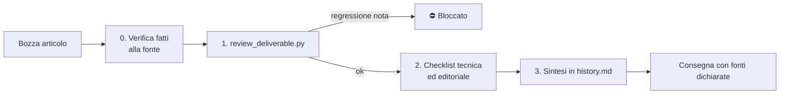

# 3 · Fact-checking automatico dei contenuti AI

**Cliente:** e-commerce di nicchia per appassionati · **Stack:** Python, Claude Code, NeuronWriter

## Il problema

Gli articoli venivano giudicati con il punteggio SEO di NeuronWriter. A settembre 2026 ho verificato alla fonte primaria cinque articoli pronti da consegnare, con punteggi **87, 87, 83, 92 e 77**.

Risultato: **15 errori fattuali**, nessuno segnalato dal punteggio. Qualche esempio:

- un prodotto descritto con una porta di comunicazione che non ha;
- un altro con un "WiFi nativo" che non esiste;
- un intero confronto basato su un catalogo prodotti non più in vendita.

Per un pubblico di appassionati esperti, errori così fanno perdere credibilità al brand in un attimo. **Un punteggio alto su un testo sbagliato è peggio di un punteggio medio su un testo corretto**, perché dà una falsa sicurezza.

## Cosa ho costruito

1. **Un protocollo di review in 4 passi**, con la verifica dei fatti come passo 0, **bloccante**:
   - ogni affermazione verificabile (prodotti, caratteristiche hardware, norme, date, prezzi) va controllata sulla fonte primaria, cioè il sito del produttore o l'ente normatore, mai solo un forum;
   - ciò che non si riesce a verificare si **toglie**, non si ammorbidisce con "in genere";
   - vietate le stime senza fonte e le affermazioni inventate sull'esperienza del cliente.
2. **Uno script Python (~580 righe), `review_deliverable.py`**, che:
   - segnala le **regressioni note**, cioè gli errori già commessi in passato, come bloccanti;
   - estrae la lista delle affermazioni da verificare;
   - senza il flag `--fatti-verificati` dà il verdetto **⛔ DA VERIFICARE** e il file non passa.
3. **Un registro delle consegne** (`history.md`, 30+ sessioni) con cosa è stato fatto, cosa ha corretto il cliente e quali errori non ripetere.

## Risultati

- I 15 errori sono stati corretti in tutti e 5 gli articoli prima della consegna, con backup degli originali.
- Alla consegna ora si dichiarano **le fonti consultate** e cosa è stato tolto; il punteggio SEO viene dopo.
- Gli errori scoperti diventano regole automatiche: lo stesso sbaglio non passa due volte.

## Cosa ho imparato

Le metriche SEO misurano l'ottimizzazione, non la verità. Con l'AI, **il controllo qualità va progettato quanto la generazione**.
