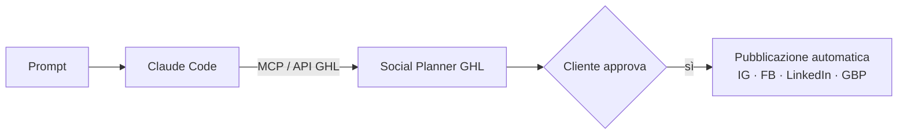

# 5 · Social su GoHighLevel guidati da Claude via MCP

**Stack:** GoHighLevel (Social Planner, CRM), Claude Code, MCP, API GHL

## Il problema

Programmare i contenuti social di più clienti su più piattaforme richiede tanto lavoro manuale: scrivere, adattare per piattaforma, caricare, fissare date e orari, far approvare al cliente.

## Cosa ho costruito

Ho progettato il collegamento tra **Claude Code e GoHighLevel tramite MCP e le API di GHL** e scritto la documentazione operativa per il team in due versioni: con integrazione attiva e senza, come ripiego manuale.

Con un'istruzione come:

> *"Crea il calendario social di maggio per il cliente X: 3 post a settimana su Instagram e Facebook, tono professionale ma accessibile"*

Claude:

1. scrive i post, con testo, hashtag e caption per ogni piattaforma;
2. li carica nel **Social Planner di GHL** già programmati;
3. li mette in stato **"da approvare"**, così GHL avvisa il cliente;
4. dopo l'approvazione GHL li pubblica in automatico.

### Dettagli tecnici

- Verifica degli **scope API** necessari prima dell'uso, per esempio la pubblicazione social.
- Estensioni previste sullo stesso canale: contatti e pipeline nel CRM, workflow di follow-up, report che aggiornano il `project-status.md` del [sistema contenuti](01-sistema-contenuti-multi-cliente.md).

## Risultati

- Il lavoro umano si riduce a **scrivere la richiesta e approvare**.

## Cosa ho imparato

MCP trasforma l'AI da "scrittore" a "operatore": non si limita a produrre testo da copiare, ma agisce direttamente negli strumenti che l'azienda usa già.
